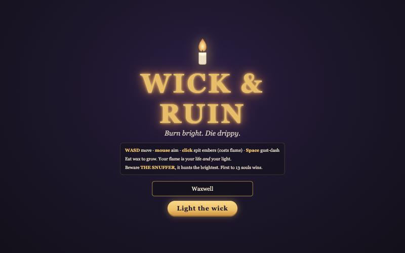
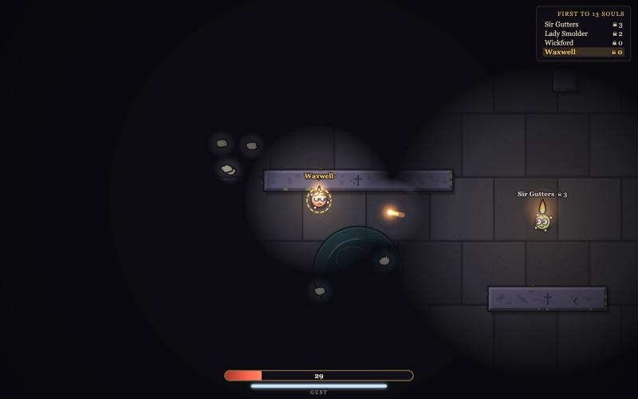
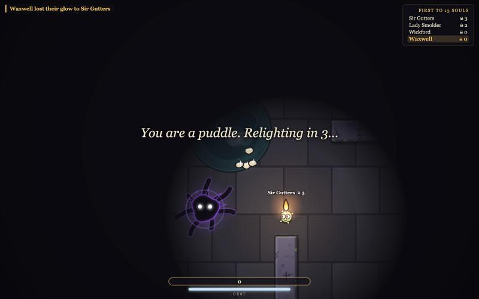

# Wick & Ruin

*Burn bright. Die drippy.*

A multiplayer arena brawler where every player is a small living candle in a pitch-dark flooded crypt. Your flame is your health **and** your light, so a wounded candle is dim and half-blind.

**Play it: https://wick-and-ruin.fly.dev/**



## The game



| | |
|---|---|
| **Move** | WASD or arrow keys |
| **Spit embers** | Aim with the mouse, hold click. Every ember costs a little of your own flame. |
| **Gust-dash** | Space, Shift or right-click. Damages candles you pass through; embers can't hit you mid-dash. |
| **Wax** | Eat puddles to burn brighter. Dead candles leave some behind. |
| **Crypt water** | Slows you and drains your flame. |
| **Win** | A kill is one soul. First to 13 souls takes the round. |

Touch devices get two virtual sticks: left to move, right to aim and fire, tap right to dash.

### The Snuffer



A huge shadow that drifts straight through walls, hunting whichever candle currently burns brightest. Being in the lead makes you its target. Embers stun it for a moment.

Bots fill the arena to four candles, so there is always someone to fight.

## Run it locally

Needs Node 22 or newer.

```bash
npm install
npm start
```

Then open http://localhost:8080. Open it in a second window to fight yourself.

## How it works

- **Server-authoritative.** The Node server runs the whole simulation at 60 Hz and broadcasts a snapshot to every client 30 times a second over WebSockets. Clients only send their inputs, so nobody can cheat by editing their own state.
- **Snapshot interpolation.** The client renders about 85 ms in the past and interpolates between the two nearest snapshots, which keeps movement smooth without client-side prediction.
- **Lighting.** The scene is drawn at full brightness, then covered by a darkness layer with a soft hole punched out for every flame. Light radius is a direct function of flame.
- **No assets, no build step.** Every sprite is drawn with Canvas 2D calls and every sound is synthesised with WebAudio. The client is plain ES modules; the only dependency is [`ws`](https://github.com/websockets/ws).
- **Idle-friendly.** The simulation freezes when no humans are connected and starts a fresh round when someone joins.

```
server/
  index.js      static files, WebSocket, simulation and broadcast loops
  game.js       the simulation: movement, embers, wax, the Snuffer, rounds
  bots.js       bot AI
public/
  main.js       networking, interpolation, main loop
  render.js     camera, floor, darkness and lighting, particles
  sprites.js    candles, the Snuffer, tombs, water
  input.js      keyboard, mouse and touch
  audio.js      synthesised sound effects and ambience
  hud.js        join screen, flame bar, scoreboard, kill feed
shared/
  constants.js  every tuning number and the map, used by server and client
```

All balance values (damage, speeds, cooldowns, the map layout) live in [`shared/constants.js`](shared/constants.js).

## Deploy

The repo includes a `Dockerfile` and `fly.toml` for [Fly.io](https://fly.io):

```bash
fly launch --copy-config
fly deploy --ha=false
```

It runs on a single machine because all game state is held in memory.

## How this was built

This game was designed and built in one session with [Claude Code](https://claude.com/claude-code). A lead agent wrote the design and a build contract ([`SPEC.md`](SPEC.md)) covering the wire protocol and module interfaces, then eight coding agents implemented the modules in parallel against that contract. The lead agent wrote the client glue, integrated the pieces, playtested, and deployed.
